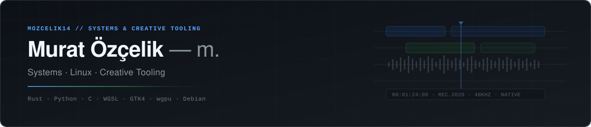

  

  <b>Bilişim Teknisyeni</b> · <b>Radyo, Televizyon ve Sinema Öğrencisi (4. Sınıf)</b> · <b>Açık Kaynak Geliştiricisi</b> · <b>Systems &amp; Creative Tooling Developer</b>

  <a href="https://mozcelik14.github.io/muratozcelik/"><b>Portfolyo / Portfolio</b></a>
  &nbsp;&nbsp;·&nbsp;&nbsp;
  <a href="https://www.linkedin.com/in/murat-%C3%B6z%C3%A7elik-398713292">LinkedIn</a>
  &nbsp;&nbsp;·&nbsp;&nbsp;
  <a href="https://instagram.com/muratozclik">Instagram</a>

---

Bolu Abant İzzet Baysal Üniversitesi Radyo, Televizyon ve Sinema 4. sınıf öğrencisiyim; lise eğitimimi Bilişim Teknolojileri / Veritabanı Programcılığı alanında tamamladım. Yazılımı sinema, ses ve müzikle aynı zeminde, kendi üretim ihtiyaçlarımdan yola çıkarak geliştiriyorum: kurguda, seste, görüntü işlemede ve günlük Linux kullanımında eksik gördüğüm araçları yerel ve kullanılabilir ürünlere dönüştürüyorum.

*Final-year Radio, Television and Cinema student at Bolu Abant İzzet Baysal University with a vocational background in IT and database programming. I build software alongside film, sound and music from my own production needs—turning the missing pieces in editing, audio, imaging and everyday Linux workflows into native, usable tools.*

---

## Öne Çıkan Projeler / Featured Projects

<table>
  <tr>
    <td width="50%" valign="top">
      <h3><a href="https://github.com/MOzcelik14/prism-suite">prisM. Suite</a></h3>
      
<b>TR:</b> <code>triM.</code>, <code>steM.</code>, <code>beaM.</code> ve <code>draM.</code> stüdyolarını tek çatı altında toplayan yerel başlatıcı, paket yöneticisi ve otomatik güncelleme merkezi.

      
<i><b>EN:</b> Native desktop launcher, package manager, and auto-updater unifying the <code>triM.</code>, <code>steM.</code>, <code>beaM.</code>, and <code>draM.</code> studios under one ecosystem.</i>

      

        
        
        
        
      

    </td>
    <td width="50%" valign="top">
      <h3><a href="https://github.com/MOzcelik14/triM">triM.</a></h3>
      
<b>TR:</b> Linux ve Windows için Electron kullanmayan yerel NLE video düzenleyici. egui/eframe arayüzü, FFmpeg donanım hızlandırma, çok kanallı zaman çizelgesi, ses miksajı, renk düzenleme, CMX 3600 EDL ve FCP XML desteği sunar.

      
<i><b>EN:</b> Electron-free native NLE video editor for Linux and Windows featuring egui/eframe, FFmpeg hardware acceleration, multi-track timeline, audio mixing, color grading, and CMX 3600 EDL / FCP XML support.</i>

      

        
        
        
        
      

    </td>
  </tr>
  <tr>
    <td width="50%" valign="top">
      <h3><a href="https://github.com/MOzcelik14/steM">steM.</a></h3>
      
<b>TR:</b> Sıfırdan Rust ile yazılan tahribatsız çok kanallı ses iş istasyonu. Lock-free SPSC gerçek zamanlı ses motoru, Demucs v4 stem ayrıştırma, kanal solo/mute/seviye kontrolü ve GPU hızlandırma içerir.

      
<i><b>EN:</b> Non-destructive multi-track audio workstation written from scratch in Rust with a lock-free SPSC real-time audio engine, Demucs v4 stem separation, per-track solo/mute/level, and GPU acceleration.</i>

      

        
        
        
        
        
      

    </td>
    <td width="50%" valign="top">
      <h3><a href="https://github.com/MOzcelik14/beaM">beaM.</a></h3>
      
<b>TR:</b> Saf Rust ile geliştirilen tahribatsız RAW fotoğraf düzenleyici. <code>.beam</code> sidecar dosyaları, WGSL gölgelendiricileriyle doğrusal Rec.2020 renk işleme hattı ve katalog yönetimi sunar.

      
<i><b>EN:</b> Non-destructive RAW photo editor built in pure Rust with <code>.beam</code> sidecar files, a WGSL-shader linear Rec.2020 color pipeline, and library catalog management.</i>

      

        
        
        
        
      

    </td>
  </tr>
  <tr>
    <td width="50%" valign="top">
      <h3><a href="https://github.com/MOzcelik14/draM">draM.</a></h3>
      
<b>TR:</b> Türkçe (<code>İÇ.</code>, <code>DIŞ.</code>, <code>(DEVAM)</code>) ve İngilizce (<code>INT.</code>, <code>EXT.</code>, <code>(CONT'D)</code>) kurallarını yerel destekleyen saf Rust senaryo yazım uygulaması. Baskı kalitesinde PDF (<code>krilla</code>), <code>.dram</code> arşivi, Fountain, Fade In ve Final Draft (<code>.fdx</code>) uyumluluğu sağlar.

      
<i><b>EN:</b> Pure-Rust screenwriting app natively supporting Turkish and English screenplay rules, print-ready PDF export via <code>krilla</code>, <code>.dram</code> archives, and Fountain / Fade In / Final Draft (<code>.fdx</code>) interoperability.</i>

      

        
        
        
        
      

    </td>
    <td width="50%" valign="top">
      <h3><a href="https://github.com/MOzcelik14/Puresteel-OS">Puresteel OS</a></h3>
      
<b>TR:</b> Debian 13 (Trixie) ve KDE Plasma 6 tabanlı bağımsız Linux dağıtımı. Calamares kurulumu, imzalı APT deposu, PySide6 tabanlı Puresteel Center, hibrit GPU desteği, ZRAM ayarları ve GitHub Actions otomatik ISO derlemesi içerir.

      
<i><b>EN:</b> Independent Linux distribution based on Debian 13 (Trixie) and KDE Plasma 6 with Calamares installer, signed APT repository, PySide6 Puresteel Center, hybrid GPU support, ZRAM tuning, and automated ISO builds.</i>

      

        
        
        
        
        
      

    </td>
  </tr>
  <tr>
    <td width="50%" valign="top">
      <h3><a href="https://github.com/MOzcelik14/Aether">Aether</a></h3>
      
<b>TR:</b> Ollama üzerinden yerel ve uzak modellerle konuşan GTK4 / Libadwaita masaüstü istemcisi. Sade sohbet arayüzü, model yönetimi ve model ayarları sunar.

      
<i><b>EN:</b> GTK4 / Libadwaita desktop client for local and remote models via Ollama, offering a clean chat interface, model management, and parameter controls.</i>

      

        
        
        
        
      

    </td>
    <td width="50%" valign="top">
      <h3><a href="https://github.com/MOzcelik14/ILEFBot">İLEFBot</a></h3>
      
<b>TR:</b> BAİBÜ İletişim Fakültesi öğrencileri için bağımsız, mobil uyumlu yapay zekâ sohbet uygulaması. OpenRouter ücretsiz modelleri, yerel sohbet geçmişi ve açık/koyu tema içerir.

      
<i><b>EN:</b> Independent, mobile-friendly AI chat web app for BAİBÜ Faculty of Communication students using OpenRouter free models, local history, and light/dark themes.</i>

      

        
        
        
        
      

    </td>
  </tr>
</table>

---

## Diğer Projeler / More Projects

<table>
  <tr>
    <td width="50%" valign="top">
      <h4><a href="https://github.com/MOzcelik14/MintGuard">MintGuard</a></h4>
      
<b>TR:</b> Linux Mint için sistem sağlığı ve bakım aracı; tüm temizlik işlemleri kullanıcı onayı ister, telemetri içermez. <i><b>EN:</b> System health and maintenance tool for Linux Mint with explicit confirmation and zero telemetry.</i>

      

        
        
      

    </td>
    <td width="50%" valign="top">
      <h4><a href="https://github.com/MOzcelik14/DebGear">DebGear</a></h4>
      
<b>TR:</b> Debian odaklı donanım ve sürücü merkezi; paket işlemleri yalnızca Debian sistemlerde etkindir. <i><b>EN:</b> Debian-focused hardware and driver center with package operations scoped to Debian systems.</i>

      

        
        
        
      

    </td>
  </tr>
  <tr>
    <td width="50%" valign="top">
      <h4><a href="https://github.com/MOzcelik14/MRT">MRT</a></h4>
      
<b>TR:</b> Standart C ile sıfırdan yazılmış dinamik tipli programlama dili ve GTK4 tabanlı MRT Studio IDE'si. <i><b>EN:</b> Dynamically typed programming language written from scratch in standard C, paired with the native GTK4 MRT Studio IDE.</i>

      

        
        
        
      

    </td>
    <td width="50%" valign="top">
      <h4><a href="https://github.com/MOzcelik14/KalemX">KalemX</a></h4>
      
<b>TR:</b> Linux masaüstü için ekran çizim ve açıklama aracı (beta; Wayland desteği masaüstü ortamına bağlıdır). <i><b>EN:</b> Desktop screen annotation and drawing tool for Linux (beta; Wayland support is compositor-dependent).</i>

      

        
        
        
      

    </td>
  </tr>
</table>

---

## Teknoloji Yığını / Tech Stack

<table>
  <tr>
    <td width="50%" valign="top">
      
<b>Diller / Languages</b>

      
<code>Rust</code> · <code>Python</code> · <code>C</code> · <code>WGSL (WebGPU)</code> · <code>C#</code> · <code>Java</code> · <code>JavaScript</code> · <code>HTML</code> · <code>CSS</code>

      
<b>Masaüstü &amp; Grafik / Desktop &amp; Graphics</b>

      
<code>egui / eframe</code> · <code>wgpu (WebGPU)</code> · <code>GTK4 / Libadwaita</code> · <code>GTK3 / Cairo</code> · <code>PySide6 (Qt 6)</code>

      
<b>Medya, Ses &amp; Video / Media, Audio &amp; Video</b>

      
<code>FFmpeg</code> · <code>cpal</code> · <code>Symphonia</code> · <code>Demucs v4</code> · <code>GStreamer</code>

    </td>
    <td width="50%" valign="top">
      
<b>Linux &amp; Sistem / Linux &amp; Systems</b>

      
<code>Debian</code> · <code>APT Paketleme</code> · <code>Flatpak</code> · <code>Calamares</code> · <code>Bash</code>

      
<b>Yapay Zekâ &amp; Araçlar / AI &amp; Tooling</b>

      
<code>Ollama</code> · <code>OpenRouter</code> · <code>Git</code> · <code>Cargo</code> · <code>GitHub Actions</code>

      
<i>Projelerdeki kullanım derinliğim farklılık gösterir; hangi teknolojinin nerede kullanıldığı yukarıdaki kartlarda belirtilmiştir. / Depth varies across tools; project cards show exact usage.</i>

    </td>
  </tr>
</table>

---

  <a href="https://mozcelik14.github.io/muratozcelik/"><b>mozcelik14.github.io/muratozcelik</b></a>

