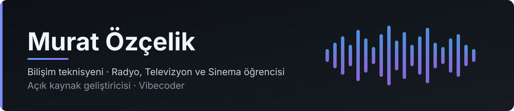

  

  <i>IT technician · Radio, Television &amp; Cinema student · Open-source developer · Vibecoder</i>

  <a href="https://muratozcelik.vercel.app/"><b>Portfolyo / Portfolio</b></a>
  &nbsp;·&nbsp;
  <a href="https://www.linkedin.com/in/murat-%C3%B6z%C3%A7elik-398713292">LinkedIn</a>
  &nbsp;·&nbsp;
  <a href="https://instagram.com/muratozclik">Instagram</a>

---

Bolu Abant İzzet Baysal Üniversitesi'nde Radyo, Televizyon ve Sinema bölümünün 4. sınıfındayım. Lisede bilişim teknolojileri / veritabanı programcılığı okudum. Yazılımı sinema, ses ve müzikle aynı yerde, kendi ihtiyaçlarımdan yola çıkarak yapıyorum: kurguda, seste ve günlük Linux kullanımında eksik bulduğum araçları tasarlıyor, geliştiriyor ve kullanılabilir bir ürüne dönüştürmeye çalışıyorum. Bazı projeler hâlâ gelişme aşamasında; her birinin durumunu ilgili depoda belirtiyorum.

*I'm a final-year Radio, Television and Cinema student at Bolu Abant İzzet Baysal University, with a vocational high school background in information technology and database programming. I build software alongside film, sound and music, starting from my own needs: I design and develop the tools I find missing in editing, audio work and everyday Linux use, and try to turn them into something usable. Some projects are still evolving; each repository states its own status.*

## Öne çıkan projeler / Featured projects

| [**Puresteel OS**](https://github.com/MOzcelik14/Puresteel-OS) |
|:--|
| Debian 13 (Trixie) ve KDE Plasma 6 tabanlı, bağımsız bir Linux dağıtımı. Oyun, yaratıcı üretim ve geliştirici araçlarını temiz bir masaüstünde toplar. Calamares tabanlı grafiksel kurulum, imzalı APT deposu, kendi sistem yönetim uygulaması Puresteel Center, Intel / AMD / NVIDIA ve hibrit GPU desteği, ZRAM ayarları ve GitHub Actions ile otomatik ISO derlemesi içerir. Debian, KDE Plasma ve Calamares gibi mevcut açık kaynak projelerin üzerine kuruludur.  *An independent Linux distribution based on Debian 13 (Trixie) and KDE Plasma 6, bringing gaming, creative and developer tools together on a clean desktop. It includes a Calamares-based installer, a signed APT repository, its own system management app (Puresteel Center), Intel / AMD / NVIDIA and hybrid GPU support, ZRAM tuning and automated ISO builds on GitHub Actions. It builds on existing open-source projects such as Debian, KDE Plasma and Calamares.*       |

| [**triM.**](https://github.com/MOzcelik14/triM) |
|:--|
| Linux ve Windows için Rust ile yazdığım, Electron kullanmayan yerel bir doğrusal olmayan video düzenleyici. egui/eframe arayüzü, FFmpeg tabanlı medya işleme, çok kanallı zaman çizelgesi, ses karıştırma, renk düzenleme, başlık klipleri ve dışa aktarma sunar; CMX 3600 EDL ve Final Cut Pro XML ile diğer kurgu programlarıyla çalışabilirliği hedefler.  *A native, Electron-free non-linear video editor for Linux and Windows, written in Rust. It offers an egui/eframe interface, FFmpeg-based media processing, a multi-track timeline, audio mixing, color grading, title clips and export, and aims for interoperability with other editors through CMX 3600 EDL and Final Cut Pro XML.*      |

| [**steM.**](https://github.com/MOzcelik14/steM) |
|:--|
| Müzik dosyalarını Demucs v4 ile vokal, davul, bas ve diğer enstrümanlara ayıran masaüstü ses uygulaması. Toplu işleme, kanal başına ses düzeyi, solo / mute, senkronize çok kanallı oynatma, dalga biçimi üzerinden gezinme ve NVIDIA CUDA ile GPU hızlandırma içerir. Linux öncelikli; Windows desteği üzerinde çalışıyorum.  *A desktop audio app that separates music into vocals, drums, bass and other instruments using Demucs v4. It includes batch processing, per-stem levels, solo / mute, synchronized multi-channel playback, waveform scrubbing and GPU acceleration through NVIDIA CUDA. Linux comes first; Windows support is a work in progress.*       |

| [**Aether**](https://github.com/MOzcelik14/Aether) |
|:--|
| Ollama üzerinden yerel veya uzak modellerle konuşan GTK4 / Libadwaita masaüstü istemcisi. Sohbet arayüzü, model yönetimi ve model ayarları sunar; amaç, kendi çalıştırdığım modelleri sade bir masaüstü uygulamasından kullanabilmek.  *A GTK4 / Libadwaita desktop client for talking to local or remote models through Ollama. It provides a chat interface, model management and model settings, so models I run myself can be used from a simple desktop app.*      |

| [**İLEFBot**](https://github.com/MOzcelik14/ILEFBot) |
|:--|
| BAİBÜ İletişim Fakültesi öğrencileri için geliştirdiğim bağımsız, mobil uyumlu bir yapay zekâ sohbet uygulaması. OpenRouter üzerinden ücretsiz modellere erişir; çoklu sohbet, tarayıcıda saklanan geçmiş ve açık / koyu tema içerir. Üniversitenin resmî hizmeti değildir.  *An independent, mobile-friendly AI chat app I built for students of the BAİBÜ Faculty of Communication. It uses free models through OpenRouter and includes multiple chats, browser-stored history and light / dark themes. It is not an official university service.*      |

## Diğer projeler / More projects

| Proje | Açıklama / Description |
|:--|:--|
| [**MintGuard**](https://github.com/MOzcelik14/MintGuard) | Linux Mint için sistem sağlığı ve bakım uygulaması. Temizlik işlemleri kullanıcı onayı ister, telemetri yoktur. *System health and maintenance app for Linux Mint. Cleanups require confirmation; no telemetry.* `Python` `PySide6` |
| [**DebGear**](https://github.com/MOzcelik14/DebGear) | Debian odaklı donanım ve sürücü merkezi. Paket işlemleri yalnızca Debian'da etkindir, evrensel bir sürücü yöneticisi değildir. *Debian-focused hardware and driver center. Package operations are enabled only on Debian; not a universal driver manager.* `Python` `GTK4` `MIT` |
| [**MRT**](https://github.com/MOzcelik14/MRT) | Standart C ile sıfırdan yazdığım dinamik tipli bir programlama dili ve GTK4 tabanlı yerel IDE'si MRT Studio. Deneysel bir çalışma. *A dynamically typed language written from scratch in standard C, with a native GTK4 IDE. Experimental.* `C` `GTK4` `MIT` |
| [**KalemX**](https://github.com/MOzcelik14/KalemX) | Linux masaüstünde ekran üzerine çizim ve açıklama aracı. Beta aşamasında; Wayland desteği masaüstü ortamına bağlı ve deneyseldir. *Screen annotation tool for Linux. In beta; Wayland support depends on the compositor and is experimental.* `Python` `GTK3 / Cairo` `MIT` |

## Teknolojiler / Technologies

  &nbsp;&nbsp;
  &nbsp;&nbsp;
  &nbsp;&nbsp;
  &nbsp;&nbsp;
  &nbsp;&nbsp;
  &nbsp;&nbsp;
  

Hepsinde aynı derinlikte değilim; hangi projede ne kullandığım yukarıda belirtilmiş durumda.
*My depth varies across these; the project entries above show what I actually use where.*

- **Diller / Languages:** Python, Rust, C, C#, Java, JavaScript, HTML, CSS
- **Masaüstü / Desktop:** GTK4 / Libadwaita, GTK3 / Cairo, PySide6 (Qt 6), egui / eframe
- **Medya ve ses / Media and audio:** FFmpeg, Demucs, GStreamer
- **Linux ve sistem / Linux and systems:** Debian, APT paketleme, Flatpak, Calamares
- **Yapay zekâ / AI:** Ollama, OpenRouter
- **Araçlar / Tooling:** Git, GitHub Actions

---

  <a href="https://muratozcelik.vercel.app/"><b>muratozcelik.vercel.app</b></a>

